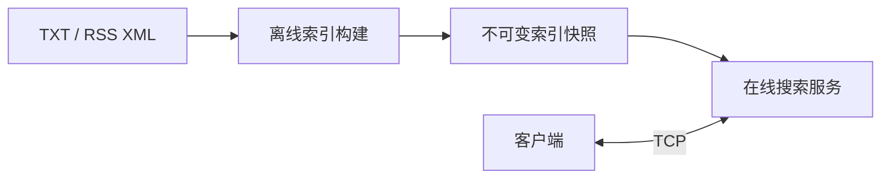

<h1 align="center">Siftwing</h1>

<strong>C++ 在线全文搜索引擎</strong>

  
  
  

Siftwing 面向 Linux，集成离线索引构建与 TCP 在线查询，提供全文检索、候选词推荐、结果摘要与关键词高亮。

## 核心特性

- **全文检索**：倒排索引、TF-IDF 余弦排序、AND / OR 查询与稳定 Top-K。
- **文本分析**：中英文分词、文本规范化、停用词过滤与 SimHash 去重，支持 TXT 和 RSS XML 输入。
- **搜索体验**：基于编辑距离与词频的候选词推荐，自动生成摘要与高亮结果。
- **网络服务**：基于 epoll 的 Main-Sub Reactor，结合固定业务线程池、有界队列与 eventfd 完成请求处理，支持背压与优雅关闭。
- **快照与缓存**：不可变索引快照、版本化 LRU 缓存，以及 C++ 控制接口下的后台加载与安全发布。
- **运行管理**：启动配置、结构化日志、运行指标与信号处理。

## 架构

`siftwing-indexer` 负责建库，`siftwing-server` 提供在线服务，`siftwing-cli` 支持本地查询与网络访问。

## 许可证

项目自身代码与原创夹具采用 [MIT License](LICENSE)。第三方依赖遵循各自许可证。
