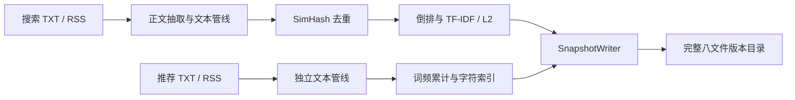
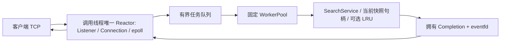

# 整体设计

Siftwing 将离线建库与在线查询分开：离线产物是完整、可校验、按版本目录保存的只读快照；在线查询只读取成功装载的内存对象。实现使用 ISO C++17，目标平台为 Linux。首次运行见[演示](DEMO.md)，精确组件接口见[组件参考](COMPONENTS.md)。

## 离线数据流



[indexer](INDEXER.md)显式选择两支输入和资源。搜索支按保留文档计算 TF、DF、平滑 IDF 和 L2 权重；推荐支累计全部交付正文中的词频，不沿用搜索去重后的 DF。标题、URL 等是显示元数据，不拼进正文词频。TXT 一文件一篇；RSS 只解析本地 RSS2 字节，必要 HTML 正文抽取不执行脚本、不访问 URL。

[Writer](SNAPSHOT_WRITER.md)先在自建临时目录生成、同步并重开校验完整成品，再无覆盖发布版本目录。发布前失败保留诊断目录；发布后父目录持久性确认失败具有独立结果，调用者不能盲目重试同版本。格式与跨文件约束集中在[快照格式](SNAPSHOT_FORMAT.md)，不在本页另建一套定义。

## 在线数据流与线程归属



生产入口在线程创建前屏蔽SIGINT/SIGTERM，由应用调用线程的唯一Reactor统一处理Listener、连接、
epoll、Completion/eventfd、timerfd和signalfd；监听与客户端socket均非阻塞，不再移交fd。
worker仍是另一组固定线程，不轮询或发送socket；可选Loader独立机制保持。
关闭时同线程主动推进网络排空，完整worker发布/通知与join后才释放通知资源，见[在线服务](ONLINE_SEARCH.md)。
[旧线程拓扑](THREAD_TOPOLOGY.md)保留主从组件合同，全面下线核对属于后续迁移批次，不能据旧图判断当前生产线程。

PING、SERVER_INFO在Reactor内处理。SEARCH/SUGGEST经单在途门禁提交拥有请求，由worker执行查询或推荐，
发布拥有响应；同一Reactor校验ConnectionId、generation、request_id、等待状态及期限后应用。
fd数字可能复用，不能代替连接身份。完整交付至输出排空保持一个在途请求；
TCP分片/合并边界由[增量解码](FRAME_DECODER.md)恢复。

[SearchService](ONLINE_SEARCH.md)复用本地 CLI 的 Query、AND/OR 候选、余弦排序、稳定 top-k、摘要/高亮和编辑距离推荐。每次计算只使用一个完整快照句柄。成功无命中是空结果，非法参数、工作预算不足和内部失败沿既有协议状态返回；客户端总期限到达只结束客户端等待，不取消 worker。

## 加载、发布与缓存

```text
单控制者提交精确路径/版本
  → 专用 Loader 完整校验
  → 取走成功候选或失败/异常
  → 控制者显式 publish
  → 后续 execute 取得新句柄；已有 execute 保留原句柄
```

[SnapshotManager](SNAPSHOT_MANAGER.md)维护当前只读 Reader 和加载报告；[Loader](SNAPSHOT_LOADER.md)按需使用专用线程，单槽覆盖等待、执行和完成未取走阶段。失败保留旧 current，成功加载也不自动发布。C++17 的 shared_ptr 原子自由函数保护当前句柄替换，最后一个所有者释放后才回收旧 Reader；不承诺无锁或后台回收。

请求在 worker 开始 execute 并取得句柄时绑定版本，排队、到达 TCP 或任务准入的顺序不能替代这个时点。版本是身份，允许回滚，不按整数大小判断发布时间。[LRU](VERSIONED_LRU.md)默认关闭，键包含版本、完整成品摘要和结果参数；同版本不同成品不会串缓存。固定查询资源仍须由调用方保证与候选相容。

[安全发布](SNAPSHOT_PUBLICATION.md)提供 SearchService/OnlineServer 的显式 C++ 控制入口；正式命令行没有 reload 命令或信号触发入口，默认不创建 Loader。演示普通服务不能证明生产信号热更新。

## 有界行为与失败收口

| 位置 | 行为与边界 |
|---|---|
| fd 接纳 | 唯一Reactor直接注册；总连接槽满关闭新源，不存在生产fd移交队列 |
| worker 等待队列 | 满时不等待空位，按同 request_id 返回 OVERLOADED；容量释放后可重新准入 |
| Completion 发布 | 结果满/拒绝或通知失败记录首因并停止整体；不能丢结果却继续声称请求正常完成 |
| 输出与期限 | 高低水位、硬限和单在途抑制无界增长；可选 idle/request 期限到期局部关闭连接 |
| 正常关闭 | 停接入和新任务，同线程限时网络排空，再完成Loader/worker及完整通知屏障，最后回收控制fd |
| 故障关闭 | 保留首因并协调停止；不把故障路径包装成正常排空 |

网络排空不证明对端已收到；关闭预算不是整个退出的硬截止。槽数、文件大小、工作预算不等于全局 RSS/CPU 上限。精确合同见[背压](OUTPUT_BACKPRESSURE.md)、[饱和](WORKER_SATURATION.md)、[期限](DEADLINES.md)和[优雅退出](GRACEFUL_SHUTDOWN.md)。

## 设计取舍与证据

选择 LT epoll 和固定连接归属，降低跨线程访问 socket 的复杂度；单在途让响应顺序、背压和错误关联可逐项验证，吞吐并行来自多连接与 worker。全内存 Reader 方便查询与持有旧版本，代价是加载和切换期间可能同时保存多份成品。TF-IDF 与完整候选评分强调可独立验证，不声称已实现 BM25 或堆式 top-k 优化。

配置只在启动装载，日志、指标与缓存有自己的同步/失败边界；跨组件指标不构成全局原子快照。当前没有 TLS、HTTP 网关、Redis、mmap、增量索引或分布式功能。测试、工具、性能及实际证据范围分别见[测试指南](TESTING.md)、[可靠性](V3_RELIABILITY.md)、[CI](CI.md)与[性能](PERFORMANCE.md)。有限测试或一次绿灯不能证明所有线程调度、生产容量或真实语料质量。

## 实现导航

| 链路 | 主要代码 |
|---|---|
| 离线输入到快照 | [indexer/main.cc](../apps/indexer/main.cc)、[snapshot/writer.cc](../src/snapshot/writer.cc) |
| 快照装载与显式发布 | [reader.cc](../src/snapshot/reader.cc)、[manager.cc](../src/snapshot/manager.cc)、[loader.cc](../src/snapshot/loader.cc) |
| 服务组合 | [server/main.cc](../apps/server/main.cc)、[online_server.cc](../src/net/online_server.cc) |
| 唯一生产循环与结果回投 | [online_server.cc](../src/net/online_server.cc)、[protocol_connection_core.cc](../src/net/protocol_connection_core.cc)、[completion_wakeup.cc](../src/net/completion_wakeup.cc) |
| 查询及客户端 | [search_service.cc](../src/query/search_service.cc)、[client.cc](../src/net/client.cc)、[cli/main.cc](../apps/cli/main.cc) |
