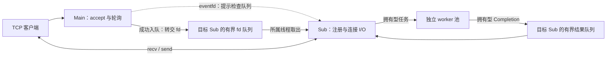

# 单 Reactor＋业务线程池：线程与所有权

## 当前生产合同

应用创建线程逐轮调用[OnlineServer](../include/siftwing/net/online_server.hpp)::run_once，独占一个LT epoll、
Listener、全部连接/Core/身份/期限、一个结果eventfd、一个timerfd和可选signalfd。
accept4取得NONBLOCK/CLOEXEC源后直接注册，没有Main→Sub交接，不保留旧主从公开API兼容层。
默认调用线程＋4个worker；可选Loader另加线程。单Reactor不是整个进程单线程。

```text
客户端 ⇄ 唯一Reactor / Core ⇄ 拥有任务 → 原worker → Completion队列＋eventfd → 同一Core
可选Loader → 完整候选 → 调用线程显式发布（不自动切换）
```

SEARCH/SUGGEST、查询缓存、摘要与序列化仍由worker执行；worker不借Connection，不操作客户端socket。
总连接/Completion条目默认各256、范围1..65536；控制token0和非零连接token分开，完整身份/等待/期限门禁保持。
报告是独立[ReactorReport/ReactorState](../include/siftwing/net/reactor_report.hpp)，由创建线程串行观察；
idle→running→draining/quiescing→stopped，不再有Sub starting/joined。连接日志module为reactor；旧日志不回写。

shutdown在同线程主动推进已在途网络至无连接或绝对期限，再完整停止Loader/worker、等待最后发布和通知，
最后撤目标及销毁Core/控制fd。网络期限不取消已接纳任务，不是总退出硬上限；closed/empty或busy=0不代替静止。
新`net.production_topology`观测真实生产I/O/worker归属、唯一epoll/timer/eventfd、信号优先和资源失败收口；
`net.single_reactor_wiring`覆盖全局256预算与不调用run_once不推进。测试中的ConnectionHarness只用于
真实Core的隔离故障/协议测试，不是另一生产框架；具体运行是否通过须读当前构建和CTest证据。

## 历史资料：旧Main/Sub（以下不是当前API或操作指南）

以下正文保留原架构的概念/生命周期说明；对应公开实现及专属测试已退役，旧代码由迁移前commit定位。
旧性能只证明原架构，不能据此声称新架构吞吐改善。

本文冻结职责、资源转交和生命周期边界。已有可执行网络命令包括
[单循环协议探针](PROTOCOL_LOOP.md)与[在线搜索服务](ONLINE_SEARCH.md)；已有独立线程的[Sub生命周期](SUB_REACTOR.md)，
已有独立[fd移交队列](FD_HANDOFF_QUEUE.md)、[eventfd唤醒组件](EVENTFD_WAKEUP.md)和[Main轮询接入组件](MAIN_REACTOR.md)；
[多Sub协议集成](MULTI_REACTOR.md)以独立ProtocolSubReactor组合Main，验证固定归属与停止屏障；旧空Sub保持，独立[WorkerPool](WORKER_POOL.md)及[SearchTask/Completion载荷](SEARCH_TASK.md)已实现，独立[CompletionQueue](COMPLETION_QUEUE.md)已提供结果邮箱；[eventfd结果回投](COMPLETION_WAKEUP.md)已提供可选请求提交/所属Sub应用路径；真实查询与生产服务命令见[在线搜索闭环](ONLINE_SEARCH.md)。
本拓扑合同不规定具体 C++ API，也不改变[协议](PROTOCOL.md)；已实现接口见对应组件文档。

## 线程与职责

在线服务拓扑包含1个Main I/O线程、启动时配置的N个Sub I/O线程（N为正，默认2）和独立worker池。
[有界业务线程池](WORKER_POOL.md)已提供固定1—64线程；真实业务已由[在线服务](ONLINE_SEARCH.md)接入，
不把硬件并发数当作必然可用线程数。每个 Reactor 使用自己的 LT epoll 和 wakeup eventfd；
正式协议Sub另独占一个[单调timerfd](DEADLINES.md)，初始disarmed，可按配置启用空闲超时与请求deadline，默认关闭。
ET、动态扩缩容、连接迁移和无锁队列留给有证据的后续扩展。

| 角色 | 所属线程内的职责与资源 | 允许的跨线程入口 | 禁止的动作 |
|---|---|---|---|
| 生命周期控制者 | 启动配置、线程拥有者、就绪/失败汇总、停止编排、join | 同步后的启动结果、停止请求、错误报告 | 直接读写/关闭活跃 Sub 的连接或 epoll；持有目标线程需要的锁时join |
| Main | Listener、监听 epoll、accept4、新 socket 配置、轮询选择、停止接入 | 有界 fd 移交、通知目标 Sub | recv/send 客户端业务数据、JSON 解析、查询/分词/文件 I/O |
| Sub | 自己的 epoll/wakeup/timerfd、连接表、Connection、Buffer、注册和写偏移 | 消费自己的 fd/Completion 队列；非阻塞提交业务任务 | 访问其他 Sub 的连接、跨 Sub 迁移连接、等待业务队列空位 |
| worker | 拥有型任务、查询/推荐/摘要/响应序列化；只读索引 | 向目标 Sub 的有界队列投递 Completion，再通知 | 持有 Connection 指针或客户端 fd；直接 epoll_ctl/recv/send |

生命周期控制者是职责，不额外要求一个常驻线程；可由应用调用线程承担。Main 的全局停止
控制负责停止接入并协调报告，不能绕过所属线程清理资源。所有 join 由线程拥有者在目标
线程之外执行；禁止 self-join、detach 代替清理或让仍可执行的线程借用已析构对象。



数据由队列持有，eventfd 只提示队列可能有工作；通知次数、任务数和连接数不相等。
Main/Sub的队列与通知协议链已有集成验证；图中worker业务执行、Completion回投和真实搜索路径
已由[在线服务](ONLINE_SEARCH.md)组合。组件测试与端到端业务测试的证据范围分别维护。

## fd 转交：每个时点只有一个拥有者

客户端 fd 使用已有 [UniqueFd](SOCKET_BASELINE.md) 的移动所有权。get() 的整数仅为同步
借用，不能跨线程保存来关闭资源；std::move 也不建立线程间同步。第一版采用有锁有界
队列，成功发布与消费通过同一同步协议建立 happens-before。

| 时点或结果 | 唯一拥有者 | 必须发生的动作 |
|---|---|---|
| accept4 成功，尚未发布 | Main 的局部 UniqueFd | 有限配置并选目标；失败由 Main 关闭一次 |
| 成功入队的提交点 | 目标 Sub 管理的队列条目 | Main 的源拥有者为空，不再读写、关闭或重新投递该 fd |
| 队列满、停止、非法目标，或提交点之前分配失败 | Main，原拥有者保持 | 不阻塞等空位；Main 关闭该新 fd，不自动改投其他 Sub |
| 入队成功，随后唤醒失败 | 目标 Sub 的队列 | 保留已转交事实；报告通知错误并进入受控停止，Main 不能取回或关闭该数字 |
| Sub 取出条目 | Sub 的局部 UniqueFd，随后 Connection | 在所属线程构造、注册；注册成功才纳入连接表 |
| 构造或注册失败 | Sub 的局部拥有者 | 关闭一次，记录本地错误；资源性/系统性失败按生命周期合同停止目标并报告 |
| 活跃连接关闭 | 所属 Sub 的 Connection | 对仍有效注册先 DEL 再 close；已自行终止则不 DEL 旧数字 |
| 停止时尚在队列中的 fd | 目标 Sub 的队列 | 在所属线程 drain 并关闭；线程退出前不得遗留队列拥有的 fd |

这里“队列属于 Sub”表示目标归属与生命周期，生产者只能使用同步后的发布入口。
提交与关闭入口必须有一个确定的先后点：先提交成功则 Sub 负责清理，先关闭则拒绝且
Main 保持拥有。不能出现“返回失败但源已被消费”，也不能用通知写入成功来定义队列提交。
fd队列已用FdHandoffResult区分accepted与closed/invalid_fd/full，公共合同见
[队列说明](FD_HANDOFF_QUEUE.md)；通知结果已有[eventfd组合接口](EVENTFD_WAKEUP.md)，区分提交与通知两个阶段。

轮询只选择就绪且接入入口开放的固定 Sub，游标按每次选定目标的移交尝试前进，
满队列不在同一尝试中重新分配；[Main组件](MAIN_REACTOR.md)与[多Sub协议组合](MULTI_REACTOR.md)已覆盖此分配边界；生产搜索服务见[在线闭环](ONLINE_SEARCH.md)。该合同不保证
相等连接数、相等负载或均衡 CPU。运行时 Sub 退出按服务失败协调停止，不静默缩容。

## 连接、队列与索引的生命周期

Connection 从注册到终止固定归属一个 Sub，保持已有“不复制、不移动、所属线程串行”
合同；必要时用 unique_ptr 保持地址稳定。Main 不保留 Connection 引用，worker 只带拥有
的输入和结果。当前 Loop 的单调 token 只是注册身份；跨线程结果的[ConnectionId/generation与路由包装](CONNECTION_IDENTITY.md)已提供独立组件并迁移Sub注册元数据；
request_id、等待状态和陈旧结果门禁已由[Sub回投路径](COMPLETION_WAKEUP.md)实现，
[期限门禁](DEADLINES.md)也在所属Sub实现；连接generation不等于请求代次，不用fd数字代替。

队列状态、停止标志与错误报告是跨线程同步对象；Connection/Buffer/epoll 状态是所属
线程对象。const、volatile、unique_ptr 或“只写一次”都不自动提供同步。队列锁内只做
有限状态与条目操作；关闭 fd、注册、回调、业务计算和 join 在释放锁后进行。

跨线程通知端点的借用也受生命期门禁保护。销毁或关闭前必须关闭发布入口，并确认
所有已进入的发布/通知调用已经返回；不能仅凭队列已空或 Main 已停止 accept 就关闭
eventfd。运行失败同样先撤销入口并协调生产者静止，再清理，不让旧借用写入复用 fd。

只读索引可以由任务保留共同生命期，但 shared_ptr 只保护拥有关系，不保护可变对象。
现有worker共享[SearchService](ONLINE_SEARCH.md)拥有的固定只读索引、分析器资源，
查询与JSON结果在每次调用中独立持有。该具体并发合同不扩大为任意const API线程安全；
[可选版本缓存](VERSIONED_LRU.md)由同一服务独占，单mutex保护LRU/get副本/统计，业务计算在锁外。
[安全发布](SNAPSHOT_PUBLICATION.md)已提供显式C++控制接口，execute按次持有同一完整快照句柄；
正式命令行没有reload入口。可选Loader占用独立线程，不属于查询WorkerPool；默认服务不创建它。
其他新增可变辅助对象仍须另证同步。

## 启动、失败与停止

1. 控制者完整预检配置并预分配固定Sub/提交器，再启动worker；线程创建、对象分配和就绪报告都有失败出口。
2. 每个 Sub 在自己的线程内建立并清理 I/O 资源，发布完整就绪或首个失败；启动中的 Sub
   不接收 fd。控制者不能仅凭线程已创建就视为就绪。
3. worker完成启动门禁、全部Sub及结果目标就绪后才开放Main接入。
   Main 的监听创建/注册失败仍须请求停止并 join 已启动 Sub，不能发布半个服务。
4. 部分启动失败时停止已启动线程、让其所属线程清理，然后逐个 join；未创建的线程
   不 join，线程函数边界吸收异常并报告首因。清理错误另记，不覆盖原失败。
5. 停止请求幂等，先关闭全局接入，再让 Main 停止 accept，关闭 fd 发布入口，阻止新请求
   和新业务任务；与提交并发的 fd 按上述提交点决定清理方。Main 确认已进入的 fd 发布与
   通知调用全部返回，控制者完成停止通知后也撤销该借用；Sub 清理前须取得生产者静止确认。
6. 在线闭环的stop保留立即丢弃模式；正常shutdown沿[限时排空](GRACEFUL_SHUTDOWN.md)；完整发布者屏障见[在线服务](ONLINE_SEARCH.md)。Sub已停止提交且worker join后，Sub关闭待接入 fd 和连接，在所属线程移除并关闭
   wakeup/epoll，再退出；控制者 join 后才能销毁队列、通知端点和线程借用的配置。
7. 立即stop流程先等Sub停止提交，再由WorkerPool关闭排空并join；完整发布/通知返回后
   撤销结果目标、release各Sub，最后由所属线程清理并join Reactor。worker可能回投时，
   接收队列及通知端点保持有效。stop不取消任务、立即丢弃网络输出；shutdown先关闭任务准入，向全部Sub发布同一截止点后关闭Main，
   Sub只排空已pending响应或截止关闭，再完成相同发布者屏障；不承诺对端收到或线程join硬上限。

跨线程停止必须有可验证的唤醒或有限等待后备路径，不允许无限 epoll_wait 配合仅写一个
停止标志。eventfd 接入前可由生命周期模块采用有限等待过渡；eventfd 接入后的通知失败
也必须能在有限时间内观察停止。超时数值和具体机制由实现模块冻结，不从“调用了 stop”
推断线程已经退出。停止请求返回、线程退出和 join 完成是三个不同事件。

## 对当前实现的影响与后续验收

现有 ProtocolLoop 独占 Listener、epoll 和连接，保留为单循环协议基线；不能把它直接放到
多个线程并共享调用，也不能让每个 Sub 通过它重新监听端口。ProtocolSubReactor已组合已有 Connection、
codec、socket 与 epoll 组件，Main 组合 Listener；共享算法需要提取时先保持旧行为并验证。
本合同不改变旧 API、所有权、线格式、快照格式或 CLI，也不引入通用回调框架。

| 实现模块 | 本合同要求其证明的行为 |
|---|---|
| Sub 生命周期 | 全就绪门禁、部分启动回滚、重复停止、所属线程资源清理、join 与异常出口 |
| fd 有界队列 | 成功消费源；满/关闭/失败保留源；关闭竞态有提交点；遗留条目关闭一次 |
| 新连接 eventfd | 队列与通知分离、合并/drain、EINTR/EAGAIN、成功提交后通知失败、发布者静止、停止可达 |
| Main 轮询与多 Sub 集成 | Main 不读写客户端；固定归属；满队列拒绝；失败协调停止；旧单 Loop 保持 |
| 有界 TaskQueue | [独立组件](TASK_QUEUE.md)已提供拥有任务移交、容量拒绝、消费者唤醒与关闭排空；[WorkerPool](WORKER_POOL.md)已提供固定线程执行与关闭排空；真实业务接入见[在线服务](ONLINE_SEARCH.md) |
| worker 与异步身份 | 无裸 Connection 指针/fd、独立数据拥有、generation 校验、过期 Completion 拒绝 |
| 优雅退出 | worker 回投端点生命期、完成/取消/排空顺序、截止时间与无线程/fd 泄漏 |

M2.12 的验证仅为合同审读与文档检查；Sub生命周期验证见[组件说明](SUB_REACTOR.md)，
独立fd队列的验证入口见[队列说明](FD_HANDOFF_QUEUE.md)。
Main/Sub连接与协议组合验证见[多Sub集成](MULTI_REACTOR.md)，独立worker生命周期见
[WorkerPool](WORKER_POOL.md)，业务接入见[在线服务](ONLINE_SEARCH.md)。吞吐、延迟、公平性
仍无性能结论；优雅退出的实际验证入口见[关闭合同](GRACEFUL_SHUTDOWN.md)，不能以本文件存在或空Sub生命周期测试通过替代。

独立eventfd唤醒协议的真实epoll验证与稳定借用停止门禁见[eventfd说明](EVENTFD_WAKEUP.md)。
